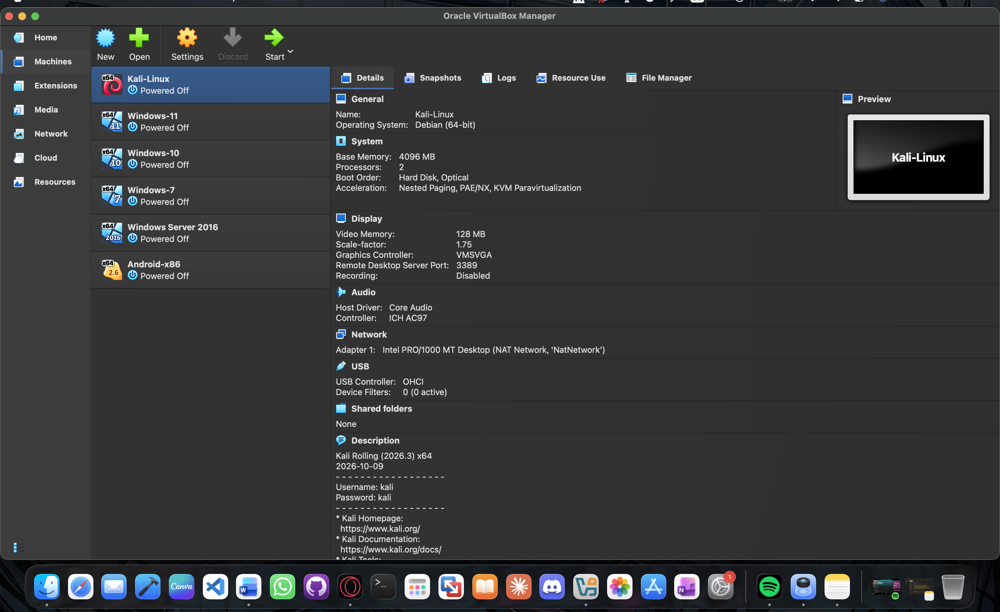
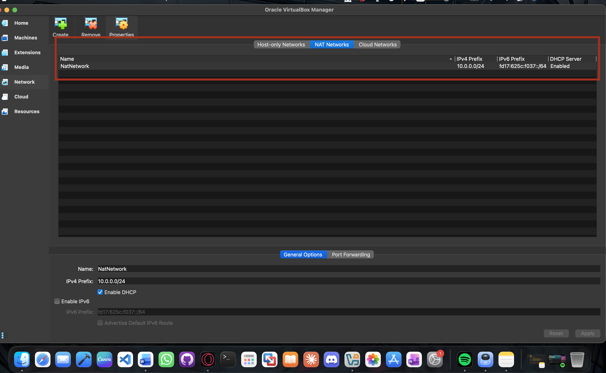
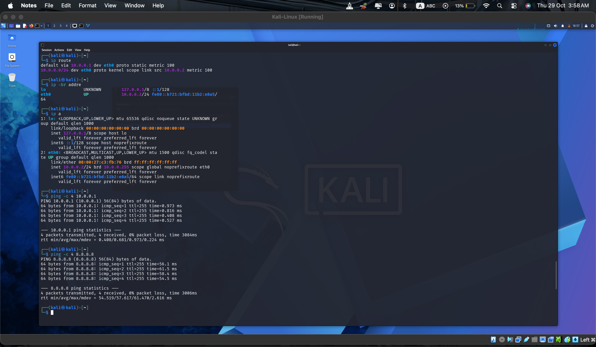
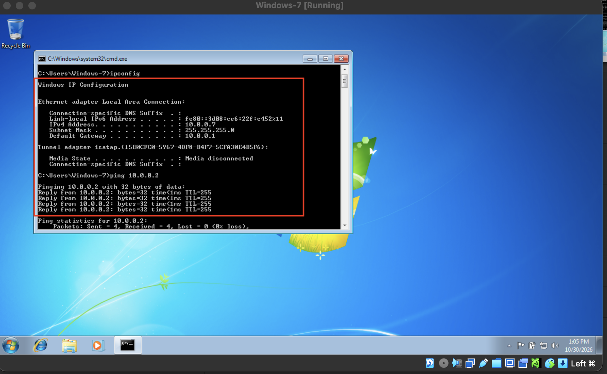
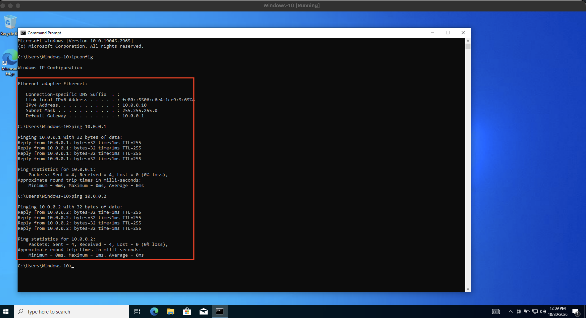
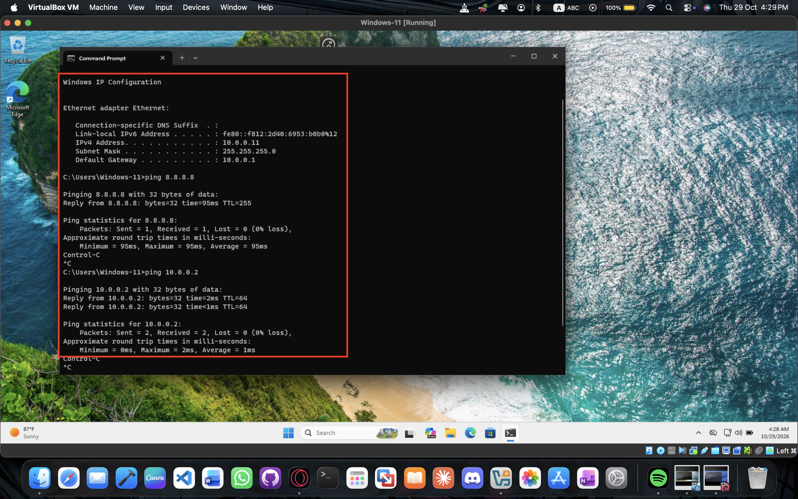
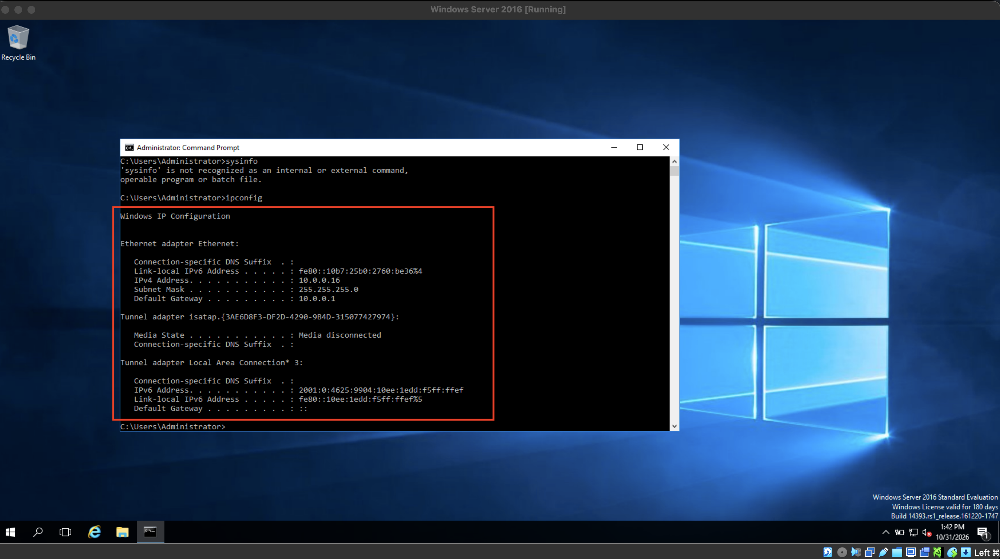
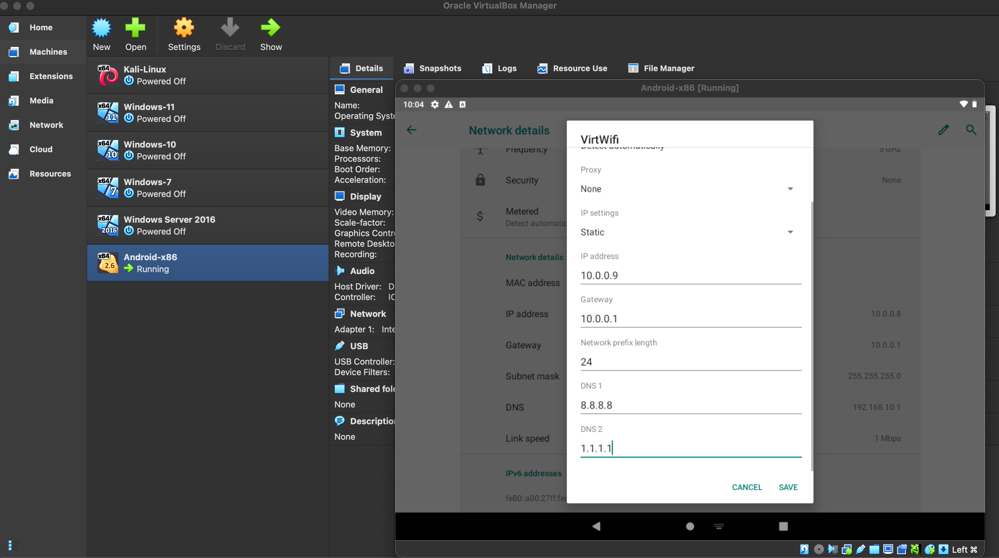

# 🔐 NETWORKWALKS-B084D
### Multi-Operating-System Virtual Network & Cybersecurity Lab

<div align="center">

**Building • Experimenting • Securing • Documenting**

A practical, multi-platform cybersecurity laboratory designed for hands-on learning, network experimentation, system administration, ethical hacking, penetration testing, and defensive security.

</div>

---

## 🏷️ Project Badges

<p align="center">


</p>

---

# 📌 1. Project Overview

**In this task I developed** a multi-operating-system virtual cybersecurity laboratory developed using Oracle VirtualBox.

The project brings together six virtual machines connected through a shared VirtualBox NAT Network. It provides a controlled environment for learning, configuring, testing, and documenting different operating systems and cybersecurity technologies.

The laboratory is designed as a long-term practical environment rather than a single installation exercise. It will progressively include networking, reconnaissance, vulnerability assessment, penetration testing, Android security, Windows administration, Active Directory, endpoint monitoring, and security automation.

The repository serves as the central documentation and portfolio space for the complete project, including infrastructure configurations, practical exercises, scripts, screenshots, findings, and technical reports.

## 🎯 Main Goals

- Build and maintain a multi-operating-system virtual laboratory.
- Understand virtualization and virtual network architecture.
- Configure and troubleshoot IPv4 networking.
- Practice network reconnaissance and service enumeration.
- Explore Windows, Linux, and Android security.
- Perform authorized vulnerability assessments and penetration testing.
- Develop defensive security and endpoint monitoring capabilities.
- Automate repetitive security tasks using scripts.
- Document practical work with reproducible steps and evidence.
- Build a professional cybersecurity portfolio through continuous hands-on projects.

---

# 🏗️ 2. Lab Architecture

The laboratory consists of a physical host system, Oracle VirtualBox, a shared NAT Network, and six virtual machines.

## Network Topology

```text
                 PHYSICAL HOST
               Intel MacBook Pro
                       |
                Oracle VirtualBox
                       |
                 NAT Network
                  NATNetwork
                10.0.0.0/24
                Gateway: 10.0.0.1
                       |
       +---------------+----------------+
       |               |                |
   Kali Linux       Windows 7        Android-x86
   10.0.0.2         10.0.0.7         10.0.0.9
       |               |                |
       +---------------+----------------+
                       |
              Shared Virtual Network
                       |
       +---------------+----------------+
       |               |                |
   Windows 10      Windows 11      Windows Server
   10.0.0.10        10.0.0.11        10.0.0.16
```

**Network Configuration:**

| Parameter | Configuration |
|---|---|
| Network Name | NATNetwork |
| Network Type | VirtualBox NAT Network |
| IPv4 Network | 10.0.0.0/24 |
| Subnet Mask | 255.255.255.0 |
| Default Gateway | 10.0.0.1 |
| DHCP | Disabled |
| Address Assignment | Static IPv4 |
| Planned Address Range | 10.0.0.2–10.0.0.99 |

---

## 3. Lab Environment

**Virtualization platform:** Oracle VirtualBox\
**Network mode:** NAT Network\
**Network name:** `NATNetwork`\
**Subnet:** `10.0.0.0/24`\
**Gateway:** `10.0.0.1`

### Virtual machine inventory

The evidence folder contains configuration screenshots for the following
systems:

  Virtual machine       Evidence
  --------------------- ------------------------------------------
  Kali Linux            `IP-configuration-Kal-Linux.png`
  Windows 7             `IP-configuration-Windows-07.png`
  Android-x86           `IP-configuration-Android.png`
  Windows 10            `Windows-10-Config.png`
  Windows 11            `IP-configuration-Windows-11.png`
  Windows Server 2016   `IP-configuration-Windows-Server-16.png`

## 4. Evidence & Proof of Concept

The screenshots below are stored in [`Evidences-and-POCs/`](Evidences-and-POCs/) and embedded directly in this document for viewing on GitHub.

### 4.1 Virtual machine inventory

This screenshot provides an overview of the virtual machines created for the lab.



*Figure 1. Virtual machines listed in Oracle VirtualBox.*

### 4.2 VirtualBox NAT Network configuration

This screenshot documents the VirtualBox NAT Network configuration used by the lab.



*Figure 2. VirtualBox NAT Network configuration.*

### 4.3 Kali Linux IP configuration



*Figure 3. Kali Linux network configuration.*

### 4.4 Windows 7 IP configuration



*Figure 4. Windows 7 network configuration.*

### 4.5 Windows 10 network configuration



*Figure 5. Windows 10 network configuration.*

### 4.6 Windows 11 IP configuration



*Figure 6. Windows 11 network configuration.*

### 4.7 Windows Server 2016 IP configuration



*Figure 7. Windows Server 2016 network configuration.*

### 4.8 Android-x86 IP configuration



*Figure 8. Android-x86 network configuration.*

## 5. Project Documentation

The detailed project report is available as a PDF:

[**View / Download NetworkWalks Documentation (PDF)**](Network-Walks-Doc-PDF.pdf)

Additional screenshots and proof-of-concept files are available in [`Evidences-and-POCs/`](Evidences-and-POCs/).


# 🖥️ 6. Virtual Machine Inventory

The lab includes the following operating systems:

| No. | Virtual Machine | Operating System | IP Address | Primary Purpose |
|---|---|---|---|---|
| 01 | Kali Linux | Kali Linux Rolling | 10.0.0.2 | Penetration Testing |
| 02 | Windows 7 | Windows 7 | 10.0.0.7 | Legacy OS Security |
| 03 | Android | Android-x86 9.0-r2 | 10.0.0.9 | Mobile Security |
| 04 | Windows 10 | Windows 10 | 10.0.0.10 | Endpoint Security |
| 05 | Windows 11 | Windows 11 | 10.0.0.11 | Modern Windows Security |
| 06 | Windows Server | Windows Server 2016 | 10.0.0.16 | Server Administration |

> **Note:** IP addresses represent the lab allocation plan. Refer to the individual machine documentation and verification evidence for confirmed configurations.

---

# ⚙️ 7. Host System & Virtualization Environment

| Component | Specification |
|---|---|
| Physical Host | Apple MacBook Pro (2019) |
| Processor Architecture | Intel x86_64 |
| Host Memory | 16 GB RAM |
| Operating System | macOS |
| Hypervisor | Oracle VirtualBox |
| VirtualBox Version | 7.2.6 |
| Virtual Disk Format | VDI |
| Virtual Network | NAT Network |

Individual VM resource allocations and disk capacities are documented in the infrastructure section.

---

# 🧰 8. Technologies & Tools

The following technologies are used or planned throughout the project.

| Category | Technologies / Tools |
|---|---|
| Virtualization | Oracle VirtualBox |
| Attacker Operating System | Kali Linux |
| Windows Environments | Windows 7, 10, 11 |
| Server Environment | Windows Server 2016 |
| Mobile Environment | Android-x86 9.0-r2 |
| Network Discovery | Nmap |
| Packet Analysis | Wireshark |
| Web Security | Burp Suite, OWASP ZAP |
| Vulnerability Assessment | Nessus |
| Security Framework | Metasploit |
| Android Communication | Android Debug Bridge (ADB) |
| Endpoint Monitoring | Wazuh |
| Automation | Python, Bash, PowerShell |
| Version Control | Git and GitHub |

*Tool availability and actual usage will be documented as individual exercises are completed.*

---

# 📂 9. Repository Structure & Directory Guide

The repository is organized into dedicated directories so that current and future practical tasks remain structured, searchable, and reproducible.

```text
NETWORKWALKS-B082/
│
├── README.md
├── LICENSE
├── .gitignore
│
├── WK1-PM1-CYBERSECURITY-LAB-SETUP/
├── README.md
├── Network-Walks-Report.pdf
├── Evidences-and-POCs/
├── List-of-VMs-on-Virtual-Box
├── IP-configuration-Android
├── IP-configuration-Kal-Linux
├── IP-configuration-Windows-07
├── IP-configuration-Windows-11
├── IP-configuration-Windows-Server-16
├── Virtual-Box-Network-Configuration-NAT
├── Windows-10-Config

```


**Contents:**
- Network topology diagrams.
- Static IP address allocation.
- NAT Network settings.
- VirtualBox network adapter configuration.
- Virtual machine inventory.
- Infrastructure changes and updates.


# 🪜 10. Project Implementation Roadmap

The project will progress through the following phases.

| Phase | Project Area | Planned Activities |
|---|---|---|
| 01 | Infrastructure | VirtualBox and network deployment |
| 02 | Operating Systems | Deploy and configure six VMs |
| 03 | Networking | IP configuration and connectivity testing |
| 04 | Reconnaissance | Nmap and network discovery |
| 05 | Traffic Analysis | Wireshark and packet inspection |
| 06 | System Security | Windows, Linux, and Android hardening |
| 07 | Server Administration | Windows Server and Active Directory |
| 08 | Offensive Security | Vulnerability assessment and penetration testing |
| 09 | Mobile Security | Android application testing |
| 10 | Defensive Security | Wazuh, logs, and endpoint monitoring |
| 11 | Automation | Python, Bash, and PowerShell |
| 12 | Reporting | Findings, documentation, and final deliverables |

*The roadmap is expandable. Individual phases will be marked complete only when practical work and evidence are available.*

---

# 🔎 11. Lab Verification & Testing

Each practical configuration should be verified before being marked complete.

Examples of common verification commands:

### Kali Linux

```bash
ip addr
ip route
ping -c 4 10.0.0.1
nmap -sn 10.0.0.0/24
```

### Windows

```powershell
ipconfig /all
ping 10.0.0.1
tracert 10.0.0.1
```

### Android

```bash
adb devices
adb connect 127.0.0.1:5555
adb shell
```

### Verification Principles

- Record the actual configuration.
- Capture command outputs.
- Save relevant screenshots.
- Document failed tests and troubleshooting.
- Do not mark unverified tasks as completed.

---

# 🐞 12. Problems Encountered & Troubleshooting

This section records technical problems, their causes, and the solutions applied during the project.

Examples of issues to document:

- VirtualBox VM startup and virtualization errors.
- Operating system installation problems.
- Static IP configuration issues.
- Network connectivity failures.
- Firewall and ICMP restrictions.
- Android-x86 boot and installation problems.
- ADB connection failures.
- Virtual machine resource limitations.

Every troubleshooting record should contain:

1. Problem description.
2. Environment and affected machine.
3. Error message or symptoms.
4. Investigation and diagnosis.
5. Solution implemented.
6. Verification result.
7. Supporting screenshots or logs.

---

# 📚 13. Learning Outcomes

The project is intended to develop practical knowledge and experience in:

- Virtualization and virtual networking.
- Operating system deployment and administration.
- IPv4 addressing and subnetting.
- Network troubleshooting and reconnaissance.
- Security testing methodologies.
- Web and mobile application security.
- Windows Server and Active Directory.
- Endpoint security and monitoring.
- Security automation and scripting.
- Technical documentation and reporting.

---

# 📸 14. Project Evidence & Documentation

Screenshots, command outputs, and diagrams are maintained throughout the repository.

Evidence naming convention:

All evidence correspond to the actual configuration or activity being documented in Evidences-and-POCs/

---

# 🔐 15. Security & Ethical Use Disclaimer

This project is developed strictly for educational purposes, cybersecurity learning, and authorized security testing.

- Test only systems that you own or have explicit permission to assess.
- Do not use the tools or techniques documented here against unauthorized targets.
- Keep sensitive information, credentials, private keys, and personal data out of the repository.
- Sanitize screenshots, logs, network captures, and reports before publishing.
- Use isolated lab environments for exploitation and vulnerability testing.

The author does not endorse or take responsibility for unauthorized use of the information provided in this repository.

---

# 🔗 16. Official Tools & References

| Resource | Official Website |
|---|---|
| Oracle VirtualBox | https://www.virtualbox.org/ |
| Kali Linux | https://www.kali.org/ |
| Microsoft Learn | https://learn.microsoft.com/ |
| Android-x86 | https://www.android-x86.org/ |
| Android Debug Bridge | https://developer.android.com/tools/adb |
| Nmap | https://nmap.org/ |
| Wireshark | https://www.wireshark.org/ |
| Burp Suite | https://portswigger.net/burp |
| OWASP | https://owasp.org/ |
| Metasploit | https://docs.metasploit.com/ |
| Wazuh | https://documentation.wazuh.com/ |
| Git | https://git-scm.com/doc |

